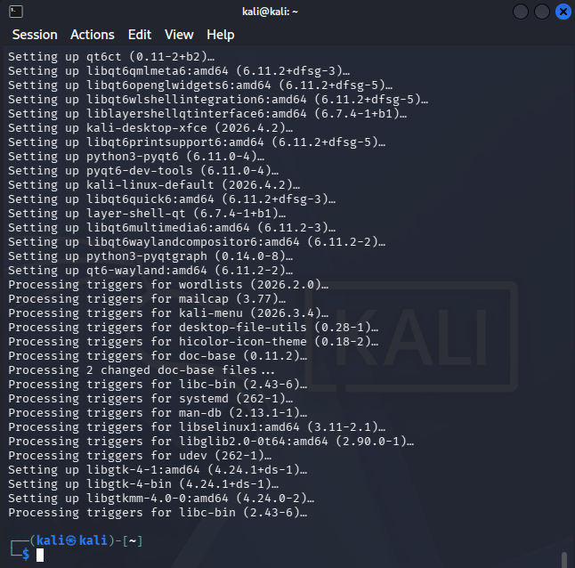

---

## 3. Actualización del sistema y guest additions

**Objetivo:** dejar Kali actualizado y con integración con el host (portapapeles
compartido y resolución automática).

```bash
sudo apt update && sudo apt full-upgrade -y
sudo apt install -y virtualbox-guest-x11
sudo reboot
```



**Resultado:** sistema actualizado y guest additions instaladas. Tras el
reinicio, la VM conserva su IP en `SecLab`.

**Snapshot:** se creó `Kali actualizado` como nuevo punto de restauración.

