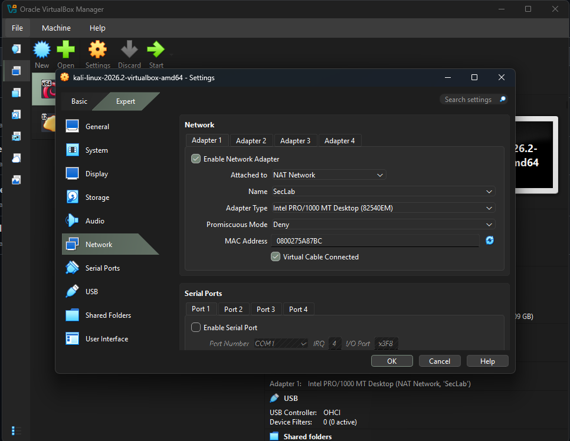
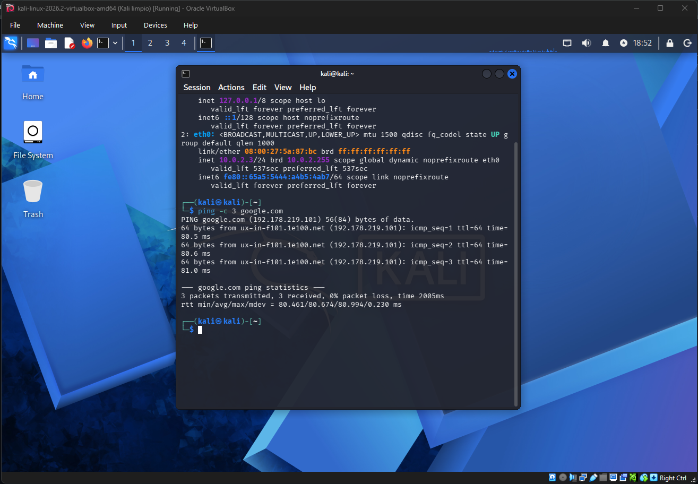
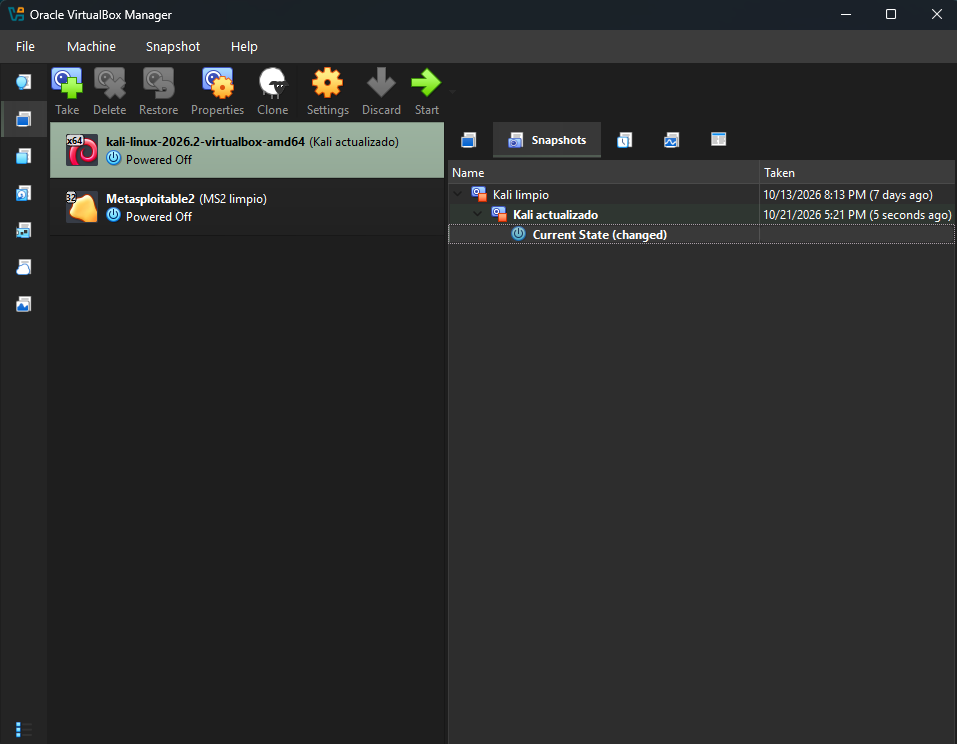
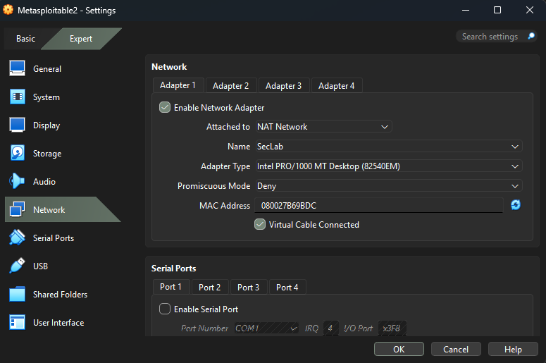
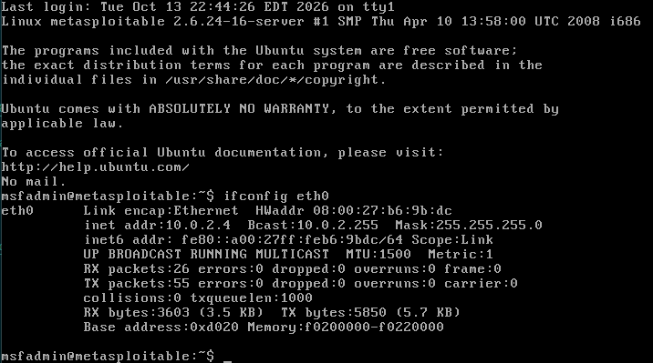
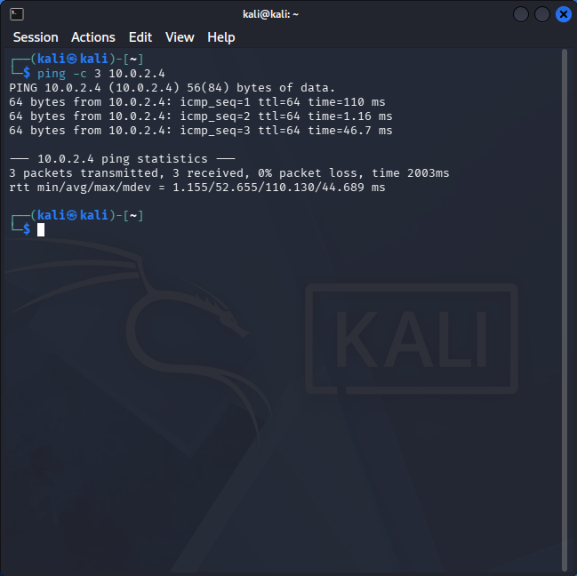
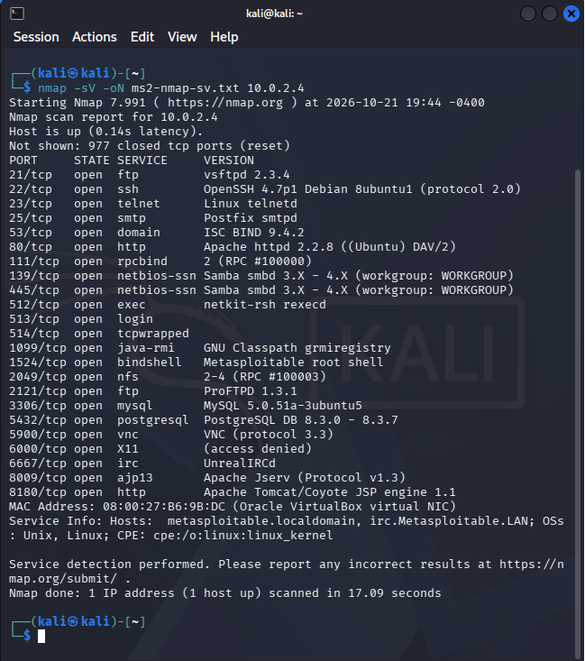
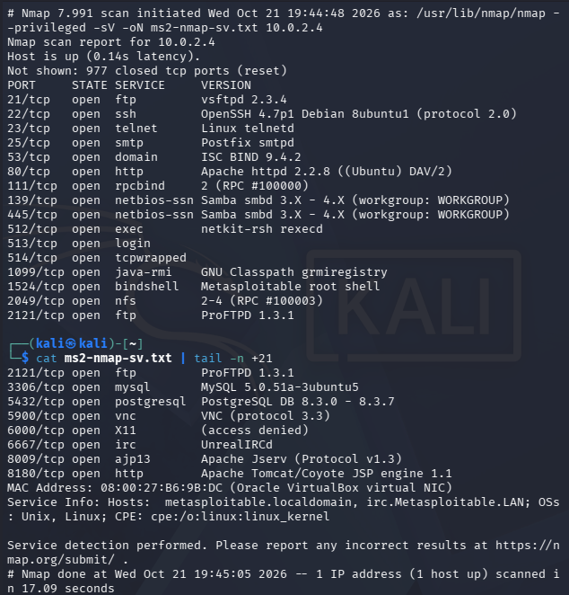

# Fase 00: Laboratorio base | TERMINADA |

## Objetivo

Montar un entorno virtual aislado con una máquina atacante (Kali Linux) y un
objetivo vulnerable (Metasploitable 2), sobre el que se construirán las
siguientes fases del proyecto.

## Entorno

- Hipervisor: Oracle VirtualBox
- Red: NAT Network `SecLab` (10.0.2.0/24)

---

## 1. Creación de la red NAT "SecLab"

**Objetivo:** crear una red virtual donde las VMs se comuniquen entre sí y
tengan salida a internet sin exponerse a la red local.

**Configuración:**

| Parámetro | Valor |
|-----------|-------|
| Nombre | SecLab |
| Prefijo IPv4 | 10.0.2.0/24 |
| DHCP | Habilitado |
| IPv6 | Deshabilitado |


**Resultado:** red `SecLab` creada y lista para conectar las VMs.

---

## 2. Máquina atacante: Kali Linux

**Objetivo:** desplegar Kali Linux como máquina atacante dentro de la red `SecLab`.

**Configuración de red de la VM:**

| Parámetro | Valor |
|-----------|-------|
| Adaptador | NAT Network |
| Red | SecLab |



**Verificación de conectividad:**

```bash
ip a
ping -c 3 google.com
```



**Resultado:** Kali (versión 2026.2) obtuvo la IP `10.0.2.3/24` por DHCP en la
interfaz `eth0` y tiene salida a internet: 3 paquetes enviados, 3 recibidos,
0% de pérdida, latencia media de ~80 ms.

**Snapshot:** se creó el snapshot `Kali limpio` como punto de restauración
antes de modificar el sistema.

---

## 3. Actualización del sistema y guest additions

**Objetivo:** dejar Kali actualizado y con integración con el host (portapapeles
compartido y resolución automática).

```bash
sudo apt update && sudo apt full-upgrade -y
sudo apt install -y virtualbox-guest-x11
sudo reboot
```


**Resultado:** sistema actualizado y guest additions instaladas. Tras el
reinicio, la VM conserva su IP en `SecLab`.

**Snapshot:** se creó `Kali actualizado` como nuevo punto de restauración.



---

## 4. Objetivo vulnerable: Metasploitable 2

**Objetivo:** desplegar una máquina vulnerable a propósito dentro de `SecLab`
como objetivo de las prácticas.

**Configuración de red:**

| Parámetro | Valor |
|-----------|-------|
| Adaptador | NAT Network |
| Red | SecLab |



> ⚠️ La VM nunca se conecta en modo puente: es vulnerable a propósito y no debe
> exponerse a redes reales.

**Dirección IP:**

```bash
ifconfig eth0
```



MS2 obtuvo la IP `10.0.2.4/24` (MAC `08:00:27:b6:9b:dc`) por DHCP.

**Verificación de conectividad desde Kali:**

```bash
ping -c 3 10.0.2.4
```



**Escaneo de servicios:**

```bash
nmap -sV -oN ms2-nmap-sv.txt 10.0.2.4
```





**Resultado:** MS2 respondió al ping con 0% de pérdida y Nmap detectó
**23 puertos abiertos** (977 cerrados) en un escaneo de 17 segundos.
Entre los servicios expuestos hay dos servidores FTP (vsftpd 2.3.4 y
ProFTPD 1.3.1), SSH (OpenSSH 4.7p1), Telnet, SMTP (Postfix), DNS (BIND 9.4.2),
HTTP (Apache 2.2.8 y Tomcat), Samba, NFS, MySQL 5.0.51a, PostgreSQL 8.3,
VNC y UnrealIRCd, todos con versiones obsoletas. Destaca el puerto 1524, que
expone una shell de root sin autenticación (*bindshell*).

**Servicios más relevantes:**

| Puerto | Servicio | Versión | Por qué importa |
|--------|----------|---------|-----------------|
| 21 | FTP | vsftpd 2.3.4 | Versión con backdoor conocido |
| 23 | Telnet | Linux telnetd | Tráfico sin cifrar |
| 1524 | bindshell | Metasploitable root shell | Acceso root sin autenticación |
| 3306 | MySQL | 5.0.51a | Versión obsoleta |
| 6667 | IRC | UnrealIRCd | Versión con backdoor conocido |

**Snapshot:** `MS2 limpio`.

---

## Tabla de direcciones

| VM | SO | IP | Red | Rol |
|----|----|----|-----|-----|
| Kali | Kali Linux 2026.2 | 10.0.2.3 | SecLab | Atacante |
| Metasploitable 2 | Ubuntu 8.04 (kernel 2.6.24) | 10.0.2.4 | SecLab | Objetivo vulnerable |

> Las IPs se asignan por DHCP y pueden cambiar entre reinicios.

---

## Problemas y soluciones

| Problema | Causa | Solución |
|----------|-------|----------|
| `mkdir -p` falló en PowerShell | `-p` es sintaxis de Linux/Bash | Usar `New-Item -ItemType Directory -Force` |
| Mensaje de commit sin cerrar comillas (prompt `>>`) | Faltaba la comilla final | `Ctrl+C` y repetir el comando |
| Imágenes rotas en el README | Capturas fuera del repo y nombres incorrectos | Moverlas a `evidence/00-setup/`, renombrarlas y usar rutas relativas `../../` |
| `code .` no reconocido | VS Code sin PATH en la terminal | Abrir la carpeta con File → Open Folder |
| Rutas duplicadas en PowerShell (`evidence\00-setup\evidence\00-setup`) | La terminal estaba dentro de la subcarpeta | Volver a la raíz del repo con `cd` antes de usar rutas relativas |

## Qué aprendí

- Cómo funciona una NAT Network en VirtualBox y por qué aísla las VMs de la red local.
- A verificar conectividad por capas: IP (`ip a`), ping y escaneo de servicios.
- A leer la salida de `nmap -sV` e identificar servicios con versiones vulnerables.
- A usar snapshots como puntos de restauración antes de modificar un sistema.
- A documentar con evidencia y a usar Git para versionar el trabajo.