# Fase 01: Diseño de red segmentada en Cisco Packet Tracer

## Objetivo

Diseñar y validar la segmentación de la red con VLANs, routing entre VLANs y
ACLs antes de implementarla con pfSense en la siguiente fase.

## Diseño

| Zona | VLAN | Subred | Equipo |
|------|------|--------|--------|
| LAN (usuarios) | 10 | 192.168.10.0/24 | PC-LAN |
| DMZ (servidores) | 20 | 192.168.20.0/24 | SRV-DMZ |
| Atacante | 30 | 192.168.30.0/24 | PC-Kali |

---

## 1. Topología

Router (R1) conectado a un switch (SW1) que agrupa tres equipos, uno por zona.

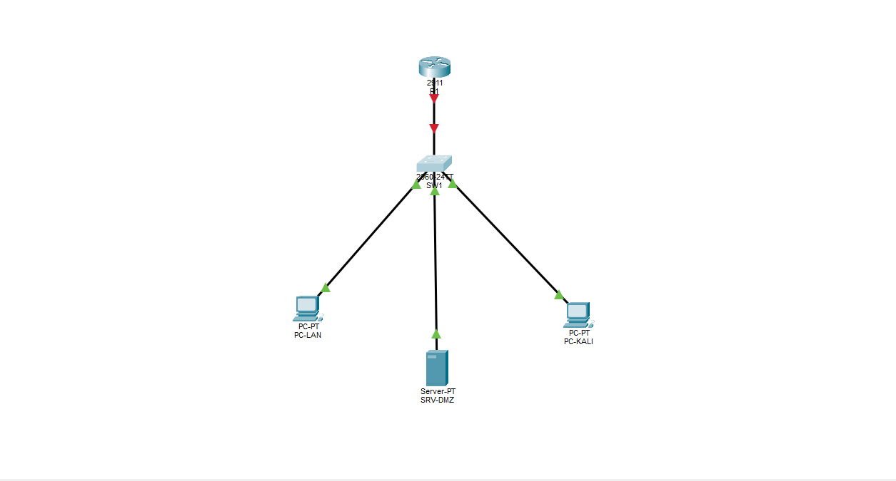

| Equipo | Puerto del switch | VLAN |
|--------|-------------------|------|
| PC-LAN | Fa0/10 | 10 (LAN) |
| SRV-DMZ | Fa0/20 | 20 (DMZ) |
| PC-Kali | Fa0/24 | 30 (ATACANTE) |
| R1 | Gig0/1 | Trunk (pendiente) |

**Estado inicial de las interfaces** (antes de configurar VLANs, todos los
puertos en VLAN 1):

```
show interfaces status
```

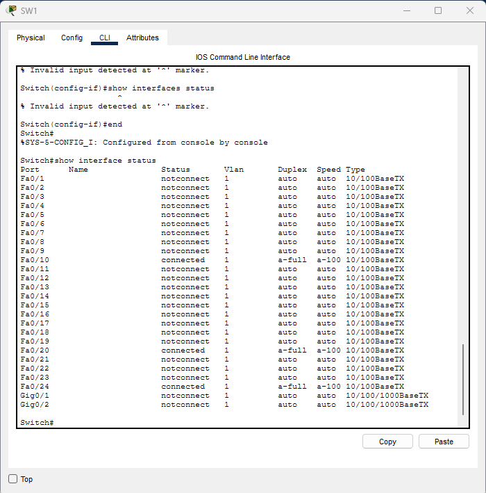

**Resultado:** los tres equipos aparecen como `connected` en los puertos
previstos (Fa0/10, Fa0/20 y Fa0/24). El enlace con el router queda como
`notconnect` porque la interfaz de R1 aún está apagada.

---

## 2. Creación de VLANs en SW1

```
hostname SW1
vlan 10
 name LAN
vlan 20
 name DMZ
vlan 30
 name ATACANTE

interface FastEthernet0/10
 switchport mode access
 switchport access vlan 10
interface FastEthernet0/20
 switchport mode access
 switchport access vlan 20
interface FastEthernet0/24
 switchport mode access
 switchport access vlan 30
```

- `vlan X` y `name` crean la VLAN con una etiqueta legible.
- `switchport mode access` fija el puerto como de usuario (una sola VLAN).
- `switchport access vlan X` asigna el puerto a su VLAN.

Verificación:

```
show vlan brief
```

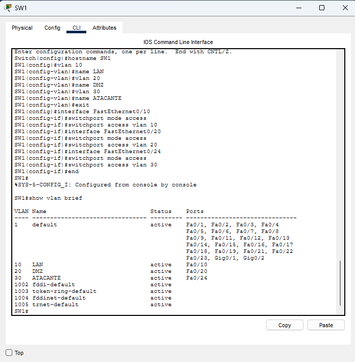

**Resultado:** tres VLANs creadas (10 LAN, 20 DMZ, 30 ATACANTE), cada equipo
asignado a la suya. Los puertos restantes permanecen en la VLAN `default`.

---

## Diagnóstico: trunk sin enlace

**Síntoma:** `show interfaces trunk` en SW1 no devolvía ninguna salida.

**Proceso de diagnóstico (de configuración a capa física):**

1. **Configuración del switch:** se verificó con
   `show running-config | section interface GigabitEthernet0/1` que Gi0/1 tenía
   `switchport mode trunk` y las VLANs 10, 20 y 30 permitidas. La
   configuración era correcta.
2. **Estado de la interfaz:** `show ip interface brief` mostró Gi0/1 en
   `down/down`, lo que apuntaba a un problema de capa física, no de
   configuración.
3. **Otro extremo del enlace:** en la topología se confirmó que Gi0/1 conecta con
   R1 (Cisco 2911), cuyas interfaces están apagadas por defecto.
4. **Solución:** `no shutdown` en la interfaz Gi0/0 de R1. El enlace subió y
   `show interfaces trunk` mostró Gi0/1 en estado `trunking` con las VLANs
   10, 20 y 30 activas.

**Aprendizaje:** un trunk correctamente configurado no aparece si el enlace está
caído. Conviene diagnosticar por capas: primero comprobar el estado físico
(`down/down`) y luego la configuración, y revisar siempre ambos extremos del
enlace.

---

## Problemas y soluciones

| Problema | Causa | Solución |
|----------|-------|----------|
| `% Invalid input detected` al usar `show` | El prompt estaba en modo configuración (`config-if`) | Escribir `end` para volver al modo privilegiado |
| `Error copying nvram:yes` al guardar | Se escribió `yes` en vez de pulsar Enter en `Destination filename` | Pulsar Enter y aceptar el nombre por defecto |
| El switch 2960 no tiene el puerto Fa0/30 | Error en el plan inicial: solo hay Fa0/1 a Fa0/24 | Usar Fa0/24 para el equipo atacante |
| Trunk con `allowed vlan 10,20,24` | Se confundió el número de puerto (Fa0/24) con la VLAN 30 | Reescribir con `switchport trunk allowed vlan 10,20,30` |
| `show interfaces trunk` salía vacío aunque el trunk estaba configurado | El enlace físico estaba caído: la interfaz Gi0/0 de R1 viene apagada por defecto | Ejecutar `no shutdown` en Gi0/0 de R1 |
| `show running-config interface ...` daba `% Invalid input` | Ese IOS de Packet Tracer no acepta esa sintaxis | Usar `show running-config \| section interface GigabitEthernet0/1` |
| `interface GigabitEthernet0/1` daba error | Se ejecutó desde modo privilegiado (`SW1#`) sin entrar antes a `configure terminal` | Entrar con `configure terminal` y luego a la interfaz |

## Próximos pasos

- Confirmar las subinterfaces de R1 con `encapsulation dot1Q`.
- Configurar IP y gateway en los equipos (PC-LAN, SRV-DMZ, PC-Kali).
- Probar conectividad con `ping` entre VLANs.
- Guardar la configuración (`copy running-config startup-config`) en R1 y SW1.
- Implementar las ACLs y validarlas con pruebas.

---

## 3. Trunk y routing entre VLANs (router-on-a-stick)

**Trunk en SW1 (Gig0/1):**

```
interface GigabitEthernet0/1
 switchport mode trunk
 switchport trunk allowed vlan 10,20,30
```

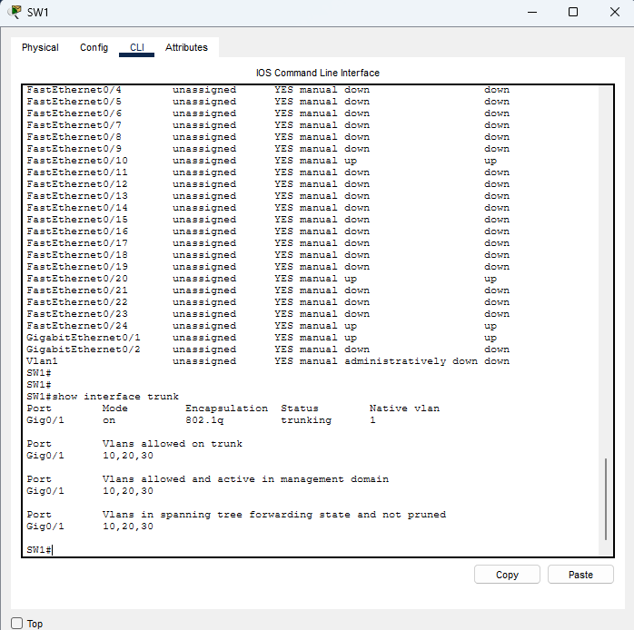

**Subinterfaces en R1 (gateways de cada VLAN):**

```
interface GigabitEthernet0/0.10
 encapsulation dot1Q 10
 ip address 192.168.10.1 255.255.255.0
interface GigabitEthernet0/0.20
 encapsulation dot1Q 20
 ip address 192.168.20.1 255.255.255.0
interface GigabitEthernet0/0.30
 encapsulation dot1Q 30
 ip address 192.168.30.1 255.255.255.0
```

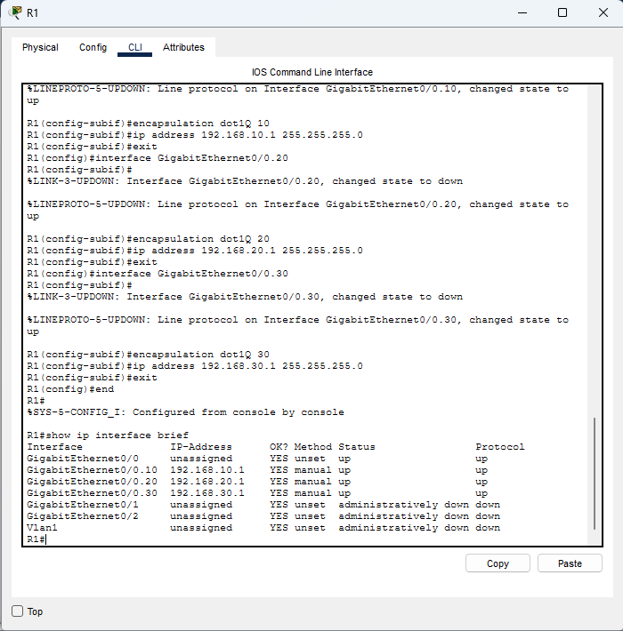

**Resultado:** el enlace SW1-R1 transporta las tres VLANs y R1 actúa como
gateway de cada una (192.168.10.1, 192.168.20.1 y 192.168.30.1).

---

## 4. Direccionamiento y pruebas de conectividad (línea base)

| Equipo | VLAN | IP | Gateway |
|--------|------|----|---------|
| PC-LAN | 10 | 192.168.10.10/24 | 192.168.10.1 |
| SRV-DMZ | 20 | 192.168.20.10/24 | 192.168.20.1 |
| PC-Kali | 30 | 192.168.30.10/24 | 192.168.30.1 |

Pruebas sin ACLs, para tener una referencia antes de aplicar la política de seguridad:

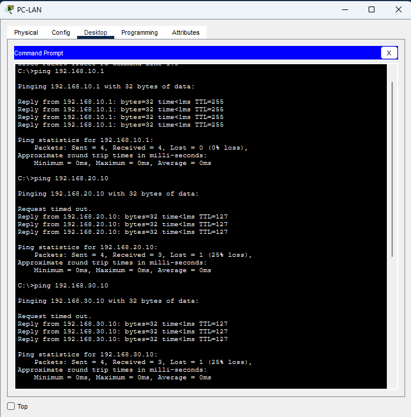
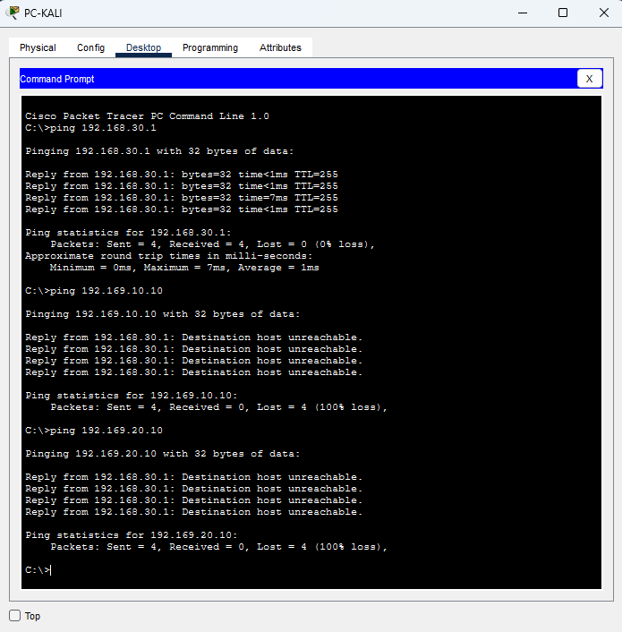

**Resultado:** el routing entre VLANs funciona; todos los equipos se alcanzan
entre sí, incluido el atacante hacia LAN y DMZ. Esto es lo que las ACLs
deben corregir.

---

## 5. Política de seguridad con ACLs

| Origen | Destino | Acción |
|--------|---------|--------|
| LAN | DMZ | Permitido |
| ATACANTE | DMZ | Solo HTTP (puerto 80) |
| ATACANTE | LAN | Bloqueado |
| DMZ | LAN | Bloqueado |

Se aplicaron ACLs extendidas con nombre en modo **inbound** en cada
subinterfaz de R1. Al ser ACLs sin estado, la ACL de la DMZ permite
explícitamente las respuestas (`echo-reply` y TCP `established`) para que LAN
siga alcanzando los servicios de la DMZ.

```
ip access-list extended ATACANTE-IN
 permit tcp 192.168.30.0 0.0.0.255 host 192.168.20.10 eq 80
 deny ip 192.168.30.0 0.0.0.255 192.168.10.0 0.0.0.255
 deny ip 192.168.30.0 0.0.0.255 192.168.20.0 0.0.0.255
 permit ip 192.168.30.0 0.0.0.255 any
```

(Configuración completa de LAN-IN, DMZ-IN y ATACANTE-IN en `show access-lists`.)

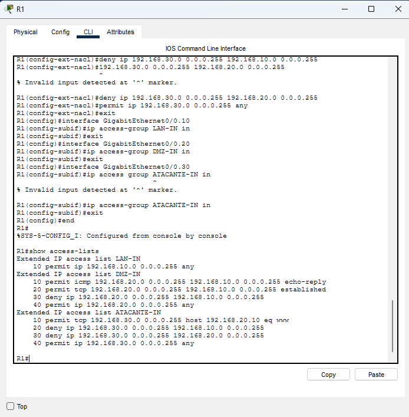

**Pruebas:**

| Origen | Destino | Resultado |
|--------|---------|-----------|
| PC-LAN | SRV-DMZ (ping y web) | Permitido |
| PC-Kali | SRV-DMZ (HTTP) | Permitido |
| PC-Kali | SRV-DMZ (ping) | Bloqueado |
| PC-Kali | PC-LAN | Bloqueado |
| SRV-DMZ | PC-LAN | Bloqueado |

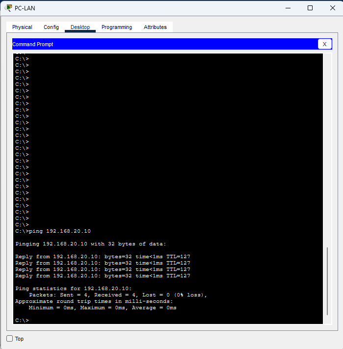
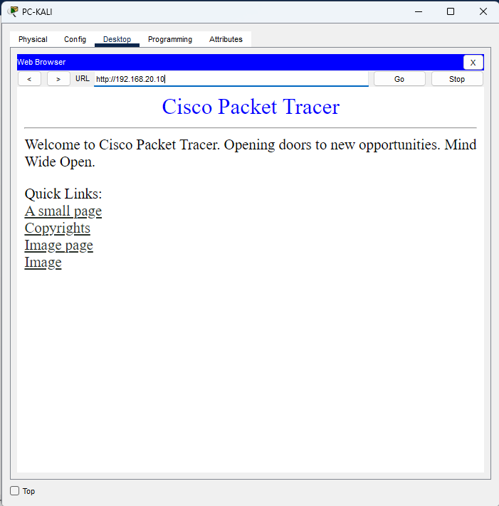
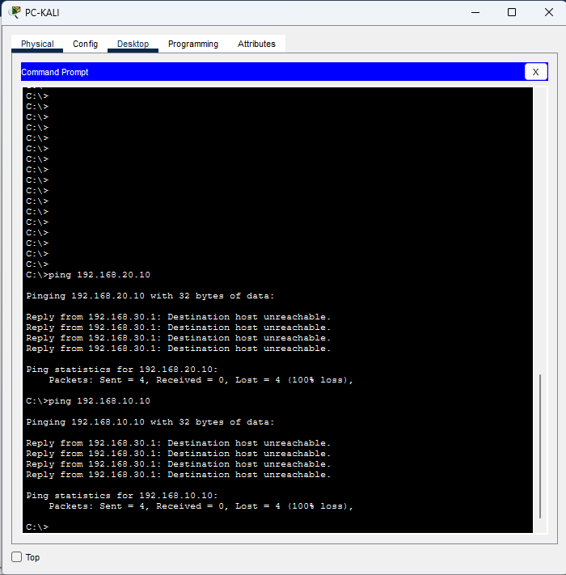
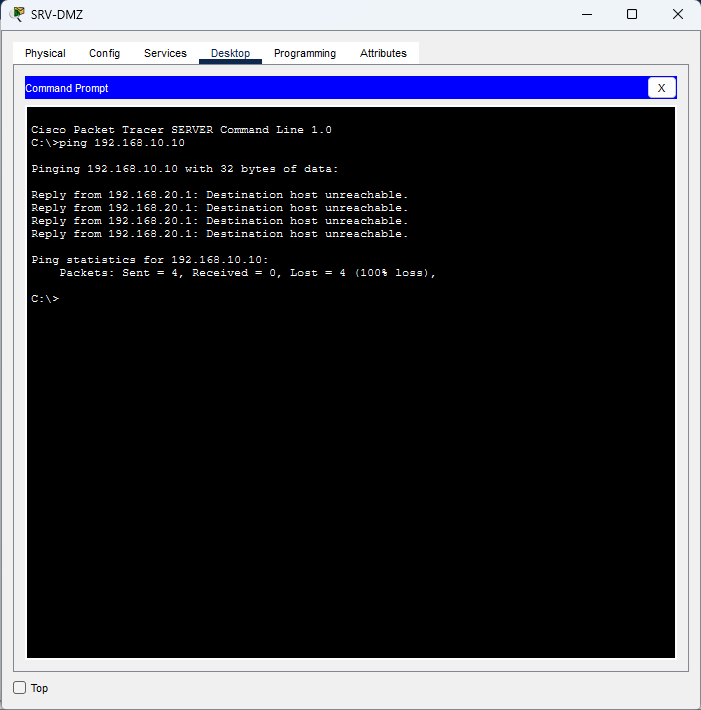

**Resultado:** la política se cumple: el atacante solo alcanza el servicio web
de la DMZ y no puede llegar a la LAN. La política es la base de las reglas que
se implementarán con pfSense en la Fase 02.