# Fase 02: Segmentación con pfSense

## Objetivo

Implementar en VirtualBox la misma segmentación diseñada en la Fase 01
(Packet Tracer), usando pfSense como firewall con estado y las máquinas reales
del laboratorio (Kali y Metasploitable 2).

## Diseño

| Zona | Red interna (VirtualBox) | Subred | Equipo |
|------|--------------------------|--------|--------|
| WAN | NAT | DHCP de VirtualBox | pfSense |
| LAN | `intnet-lan` | 192.168.10.0/24 | Cliente |
| DMZ | `intnet-dmz` | 192.168.20.0/24 | Metasploitable 2 |
| ATACANTE | `intnet-atacante` | 192.168.30.0/24 | Kali |

---

## 1. VM de pfSense

**Recursos:** 1 GB de RAM, 1 CPU, disco de 10 GB, FreeBSD (64-bit).

**Adaptadores de red:**

| Adaptador | Tipo | Nombre | Función |
|-----------|------|--------|---------|
| 1 | NAT | n/a | WAN |
| 2 | Red interna | `intnet-lan` | LAN |
| 3 | Red interna | `intnet-dmz` | DMZ |
| 4 | Red interna | `intnet-atacante` | ATACANTE |

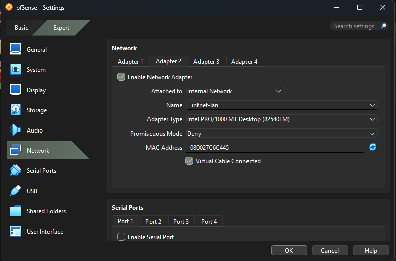

> Se usó el instalador de Netgate (`netgate-installer`), que descarga pfSense CE
> durante la instalación, por lo que la VM necesita salida a internet por el
> adaptador NAT.

---

## 2. Instalación de pfSense CE

Se utilizó el instalador de Netgate (`netgate-installer v1.2`), que descarga
pfSense durante el proceso.

1. Asignación de interfaces: `em0` como WAN (adaptador NAT) y `em1` como LAN
   (`intnet-lan`).
2. El instalador ofreció pfSense Plus (de pago); se eligió **Install CE**, la
   edición gratuita.
3. Instalación en el disco virtual `ada0` (10 GB).

Las interfaces DMZ (`em2`) y ATACANTE (`em3`) se asignan tras la instalación,
desde la consola de pfSense.

---

## Problemas y soluciones

| Problema | Causa | Solución |
|----------|-------|----------|
| VirtualBox marcaba error en la ruta del ISO | 7-Zip creó una carpeta con el nombre `.iso` y el archivo real estaba dentro, así que la ruta salía duplicada | Mover el `.iso` un nivel arriba y seleccionarlo desde el explorador |
| Tras instalar, la consola solo mostraba la WAN | El instalador solo configura WAN y LAN | Asignar todas las interfaces con la opción 1 de la consola |
| `connect: Invalid argument` al hacer ping en MS2 | Se escribió `ping 3 IP` sin la opción `-c` | Usar `ping -c 3 IP` |
| `curl` al puerto 80 de la DMZ daba timeout | La regla Pass estaba debajo de la Block `NET_DMZ` (gana la primera coincidencia) y, tras reordenarla, faltó pulsar `Apply Changes` | Mover la Pass al principio y aplicar los cambios; diagnóstico comparando con Kali-LAN, que sí alcanzaba MS2 |

---

## 3. Asignación de interfaces y direccionamiento

Desde la consola de pfSense se asignaron las interfaces y las IPs, usando las
mismas subredes del diseño en Packet Tracer:

| Interfaz | NIC | Red interna | IP | DHCP |
|----------|-----|-------------|----|------|
| WAN | em0 | NAT | 10.0.2.15/24 (DHCP) | n/a |
| LAN | em1 | `intnet-lan` | 192.168.10.1/24 | .100 a .200 |
| OPT1 (DMZ) | em2 | `intnet-dmz` | 192.168.20.1/24 | No |
| OPT2 (ATACANTE) | em3 | `intnet-atacante` | 192.168.30.1/24 | .100 a .200 |

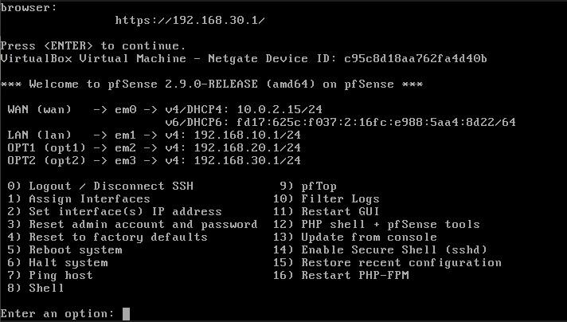

## 4. Conexión de Kali y Metasploitable 2

| VM | Red interna | IP | Método |
|----|-------------|----|--------|
| Kali | `intnet-atacante` | 192.168.30.100 | DHCP de pfSense |
| Metasploitable 2 | `intnet-dmz` | 192.168.20.10 | Estática |

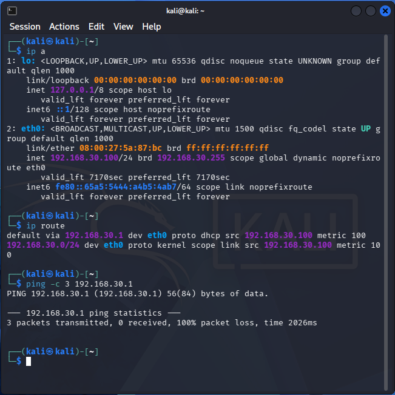
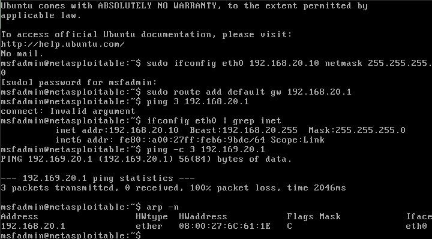

**Resultado:** ambas VMs obtienen direccionamiento coherente con el diseño de
la Fase 01. Los pings al gateway fallan porque pfSense bloquea por defecto el
tráfico entrante en las interfaces OPT hasta que se crean reglas.

---

## 5. Alias de firewall

Se crearon alias para dar nombres legibles a las redes y al servidor objetivo,
de modo que las reglas se lean como la política de seguridad.

| Alias | Tipo | Valor |
|-------|------|-------|
| `NET_LAN` | Network | 192.168.10.0/24 |
| `NET_DMZ` | Network | 192.168.20.0/24 |
| `NET_ATACANTE` | Network | 192.168.30.0/24 |
| `SRV_MS2` | Host | 192.168.20.10 |

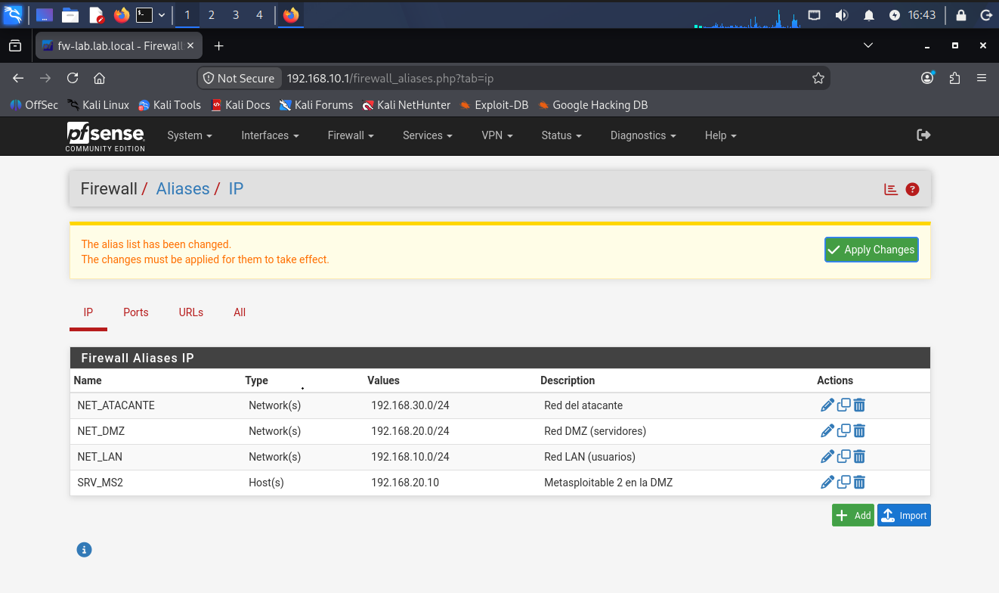

---

## 6. Reglas de firewall

Misma política que las ACLs de la Fase 01. Las reglas se evalúan de arriba a
abajo y se aplican a la entrada de cada interfaz. A diferencia de las ACLs de
Cisco (sin estado), pfSense es un firewall con estado: las respuestas del
tráfico permitido pasan solas, sin reglas `established` ni `echo-reply`.

**Interfaz OPT2 (ATACANTE):**

| # | Acción | Protocolo | Origen | Destino | Puerto | Descripción |
|---|--------|-----------|--------|---------|--------|-------------|
| 1 | Pass | TCP | `NET_ATACANTE` | `SRV_MS2` | 80 | Atacante a web de DMZ |
| 2 | Block | Any | `NET_ATACANTE` | `NET_LAN` | any | Atacante a LAN bloqueado |
| 3 | Block | Any | `NET_ATACANTE` | `NET_DMZ` | any | Atacante al resto de DMZ bloqueado |

**Interfaz OPT1 (DMZ):**

| # | Acción | Protocolo | Origen | Destino | Descripción |
|---|--------|-----------|--------|---------|-------------|
| 1 | Block | Any | `NET_DMZ` | `NET_LAN` | DMZ a LAN bloqueado |

**Interfaz LAN:** se mantiene la regla por defecto (permitir todo), que cubre
*LAN → DMZ permitido*.

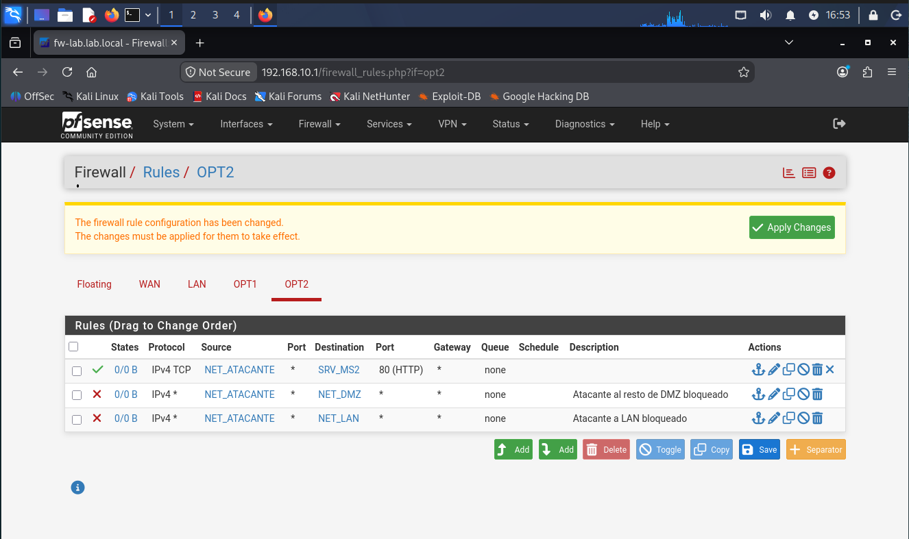
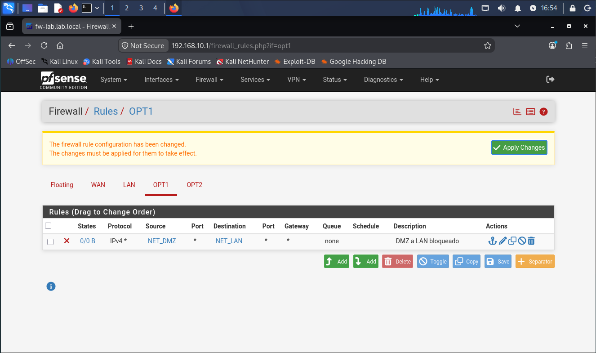

### Comparación con la Fase 01

| Política | ACL en Cisco (Fase 01) | Regla en pfSense (Fase 02) |
|----------|------------------------|----------------------------|
| Atacante → DMZ solo HTTP | `permit tcp ... eq 80` + `deny ip` | Pass TCP 80 + Block |
| Atacante → LAN | `deny ip` | Block |
| DMZ → LAN | `deny` + permitir `established`/`echo-reply` | Block (el estado lo gestiona el firewall) |

---

## 7. Reglas de firewall

Misma política que las ACLs de la Fase 01. Las reglas se evalúan de arriba a
abajo y gana la primera que coincide; se aplican a la entrada de cada
interfaz. A diferencia de las ACLs de Cisco (sin estado), pfSense es un
firewall con estado: las respuestas del tráfico permitido pasan solas, sin
reglas `established` ni `echo-reply`.

**Interfaz OPT2 (ATACANTE):**

| # | Acción | Protocolo | Origen | Destino | Puerto | Descripción |
|---|--------|-----------|--------|---------|--------|-------------|
| 1 | Pass | TCP | `NET_ATACANTE` | `SRV_MS2` | 80 | Atacante a web de DMZ |
| 2 | Block | Any | `NET_ATACANTE` | `NET_LAN` | any | Atacante a LAN bloqueado |
| 3 | Block | Any | `NET_ATACANTE` | `NET_DMZ` | any | Atacante al resto de DMZ bloqueado |

**Interfaz OPT1 (DMZ):**

| # | Acción | Protocolo | Origen | Destino | Descripción |
|---|--------|-----------|--------|---------|-------------|
| 1 | Block | Any | `NET_DMZ` | `NET_LAN` | DMZ a LAN bloqueado |

**Interfaz LAN:** se mantiene la regla por defecto (permitir todo), que cubre
*LAN → DMZ permitido*.

> El orden es crítico: la regla Pass del puerto 80 debe ir **antes** de la
> regla Block de `NET_DMZ`, porque `SRV_MS2` pertenece a esa red.


### Comparación con la Fase 01

| Política | ACL en Cisco (Fase 01) | Regla en pfSense (Fase 02) |
|----------|------------------------|----------------------------|
| Atacante → DMZ solo HTTP | `permit tcp ... eq 80` + `deny ip` | Pass TCP 80 + Block |
| Atacante → LAN | `deny ip` | Block |
| DMZ → LAN | `deny` + permitir `established`/`echo-reply` | Block (el estado lo gestiona el firewall) |

---

## 8. Validación de la política

Se validó la política con el Kali real del laboratorio.

**Atacante → DMZ** (`curl` y `nmap -sV -Pn 192.168.20.10`):

```bash
curl -I --max-time 5 http://192.168.20.10
nmap -sV -Pn -oN pfsense-atacante-dmz.txt 192.168.20.10
```

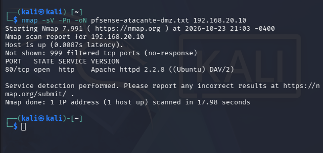

| | Fase 00 (red plana) | Fase 02 (pfSense) |
|---|---|---|
| Puertos abiertos | 23 | 1 (80/tcp) |
| Estado del resto | closed (responden RST) | filtered (sin respuesta) |

**Resultado:** el atacante solo alcanza el servicio web de la DMZ. La
superficie de ataque pasó de 23 a 1 puerto (96 % menos), y el firewall
descarta el resto sin responder, lo que dificulta el reconocimiento.

**Pruebas de la política:**

| Origen | Destino | Esperado | Resultado |
|--------|---------|----------|-----------|
| Atacante | DMZ | Solo 80/tcp | ✅ 1 puerto abierto, 999 `filtered` |
| Atacante | LAN | Bloqueado | ✅ Puertos `filtered` y ping sin respuesta |
| LAN | DMZ | Permitido | ✅ 23 puertos abiertos |
| DMZ | LAN | Bloqueado | ✅ 100% de pérdida de paquetes |

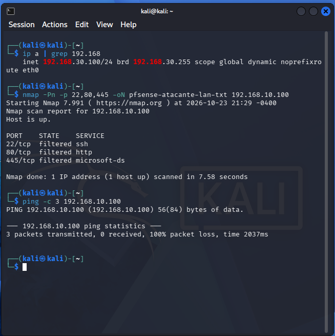
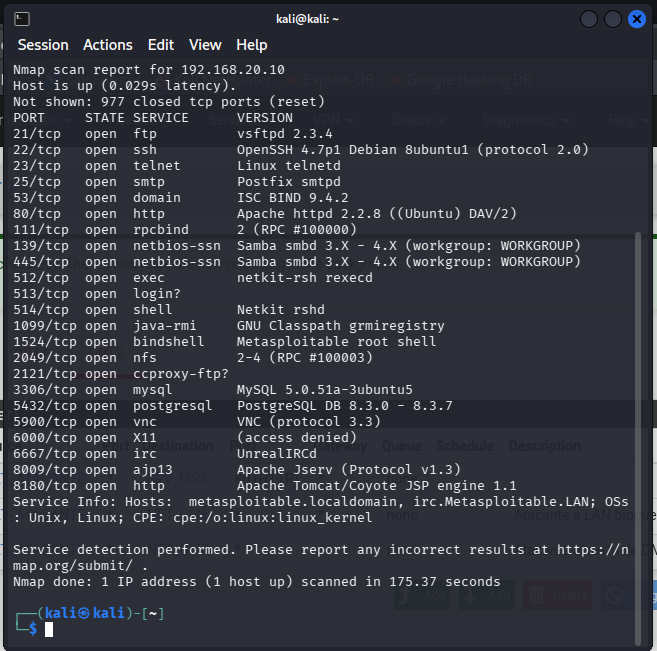
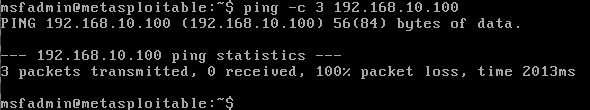

**Evidencia en los logs del firewall:** con *Log packets* activado en las reglas
Block, pfSense registra los intentos del atacante hacia la LAN, identificados
con el nombre de la regla (*Atacante a LAN bloqueado*) y no con la regla por
defecto.

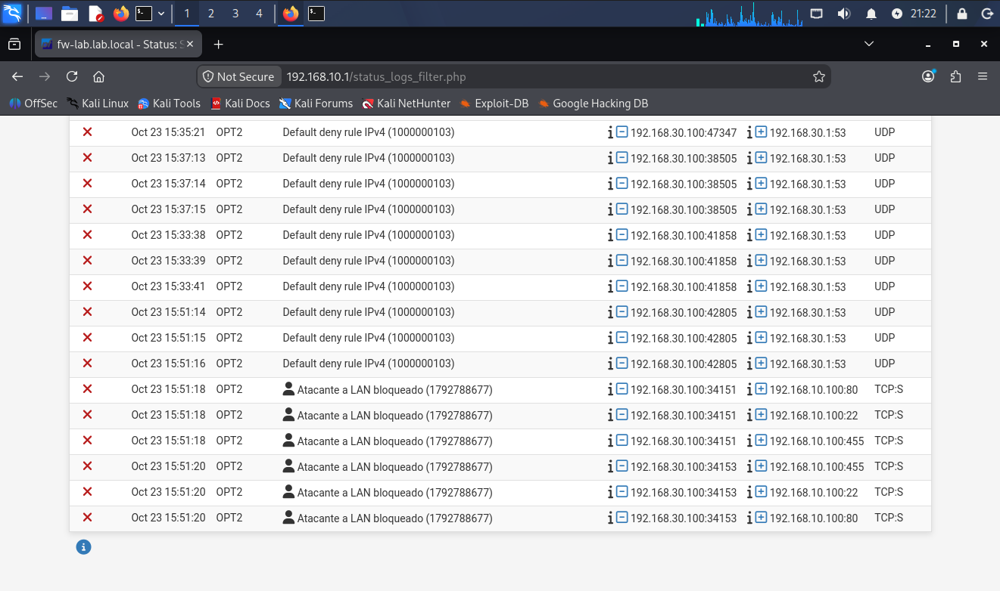

**Conclusión:** la política diseñada en Packet Tracer se reproduce en pfSense
con herramientas reales: el atacante solo alcanza el puerto 80 de la DMZ, no
llega a la LAN, y la DMZ no puede iniciar conexiones hacia la LAN.