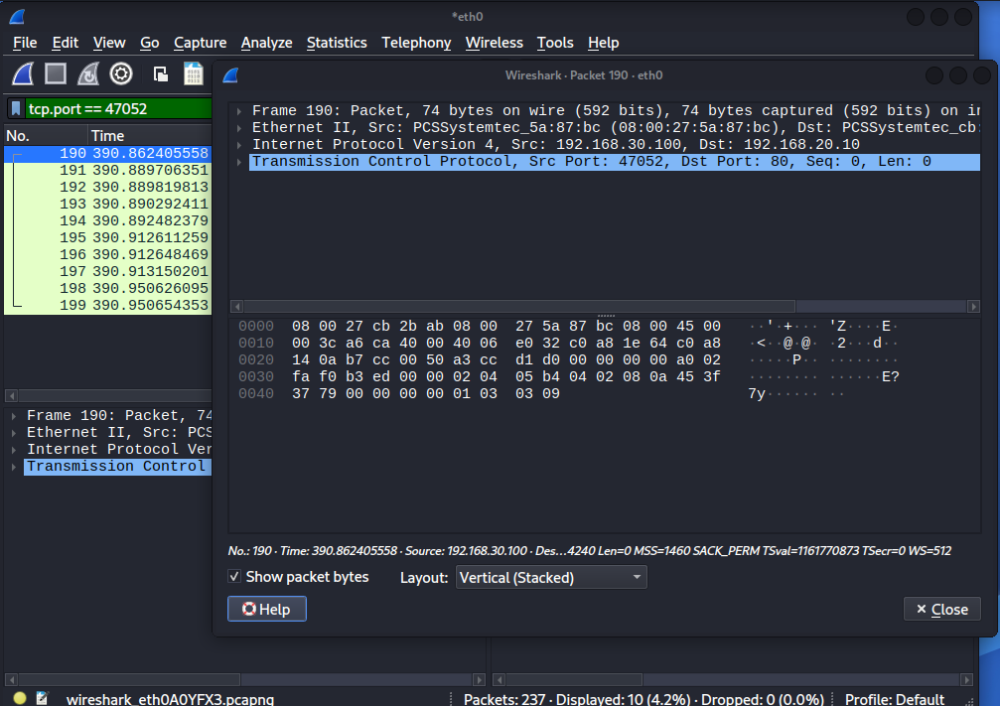
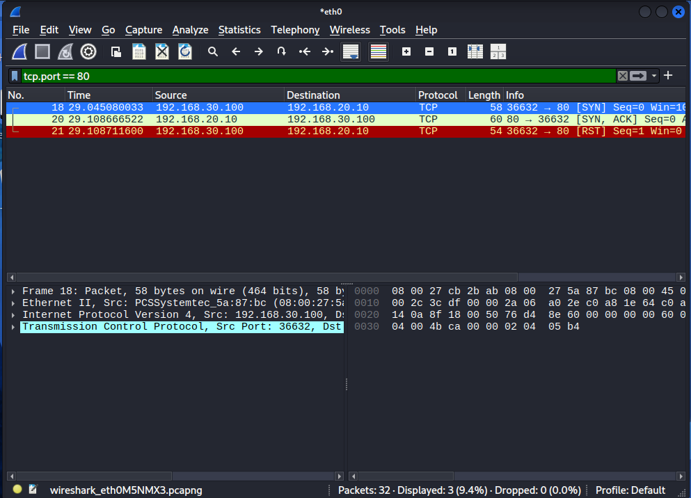
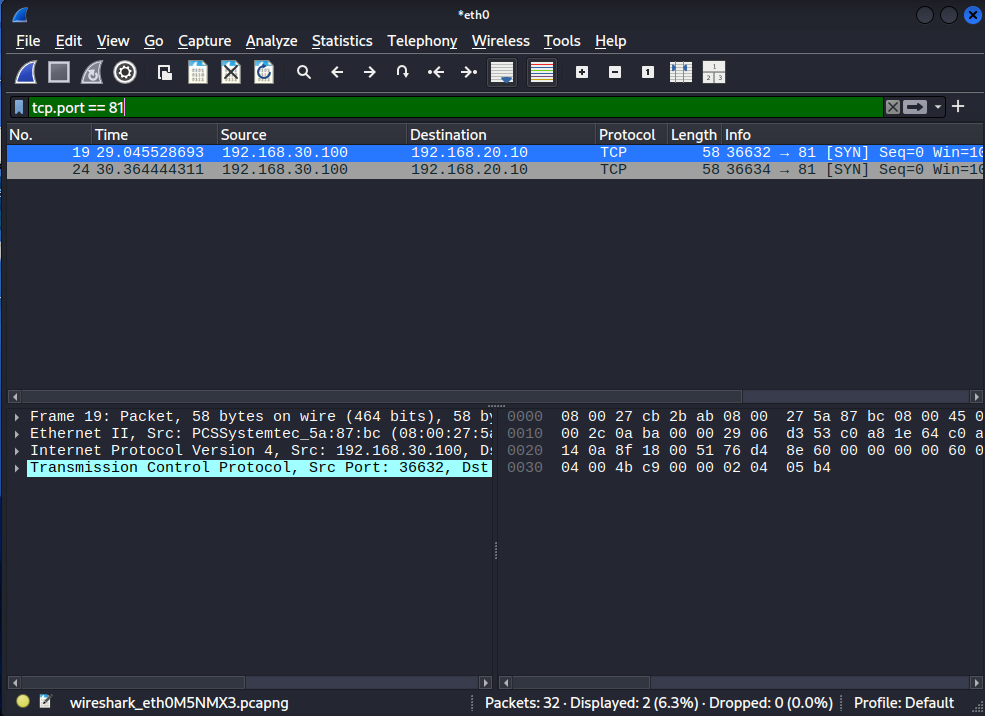
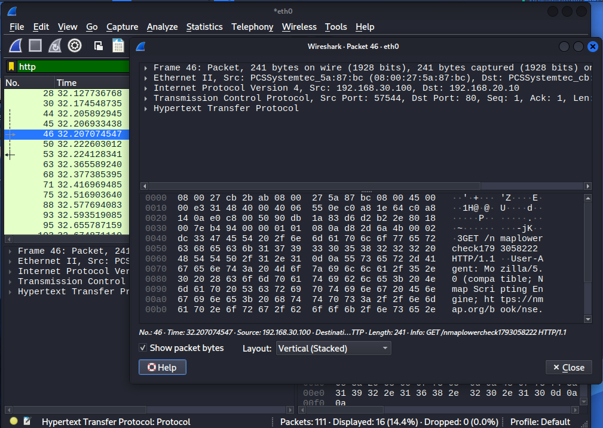

# Fase 03: Análisis de tráfico con Wireshark

## Objetivo

Observar cómo se ve en la red el tráfico del atacante hacia la DMZ, para
entender qué paquetes genera cada acción y preparar las reglas de detección
de la Fase 04.

**Punto de captura:** interfaz `eth0` de Kali (atacante), `192.168.30.100`.

---

## 1. Handshake TCP (conexión correcta)

```bash
curl -I http://192.168.20.10
```

Filtro: `tcp.port == 47052`



| Paquete | Descripción |
|---------|-------------|
| `[SYN]` | Kali solicita abrir la conexión |
| `[SYN, ACK]` | MS2 acepta |
| `[ACK]` | Handshake completo |
| `HEAD / HTTP/1.1` | Petición del `curl` |
| `HTTP/1.1 200 OK` | Respuesta de Apache |
| `[FIN, ACK]` | Cierre ordenado |

La trama del atacante lleva como MAC de destino la interfaz del firewall
(`em3`), no la de MS2: todo el tráfico entre zonas pasa por pfSense.

---

## 2. Escaneo SYN: puerto abierto frente a filtrado

```bash
sudo nmap -sS -Pn -p 80,81 192.168.20.10
```

**Puerto 80 (abierto):** el atacante envía `[SYN]`, MS2 responde `[SYN, ACK]` y
Nmap corta con `[RST]` sin completar el handshake (escaneo *half-open*).



**Puerto 81 (filtrado):** el `[SYN]` no recibe ninguna respuesta. Nmap lo
reenvía una vez desde otro puerto de origen (36632 y 36634) y, al no obtener
respuesta, marca el puerto como `filtered`. pfSense descarta el paquete en
silencio.



| Estado | Respuesta en la red |
|--------|---------------------|
| Abierto | `[SYN, ACK]` |
| Cerrado (Fase 00, red plana) | `[RST, ACK]` |
| Filtrado (Fase 02, con firewall) | Ninguna: solo `[SYN]` sin respuesta |

**Aprendizaje:** el firewall no solo reduce los puertos alcanzables; también
cambia lo que el atacante puede deducir, porque descartar sin responder
oculta si el puerto existe.

---

## 3. Huella de `nmap -sV` en tráfico HTTP

```bash
nmap -sV -Pn -p 80 192.168.20.10
```

Filtro: `http`



La detección de versiones envía en medio segundo una ráfaga de peticiones a
rutas que ningún usuario legítimo pediría:

| Petición | Finalidad |
|----------|-----------|
| `GET / HTTP/1.0` | Sonda inicial con HTTP/1.0 |
| `POST /sdk` | Busca servicios VMware |
| `GET /nmaplowercheck...` | Sonda de prueba con "nmap" en la ruta |
| `GET /evox/about` | Sonda de otro servicio |
| `GET /HNAP1` | Sonda de routers (HNAP) |

El servidor responde `200 OK` a la raíz y `404 Not Found` a casi todo lo demás.

**Aprendizaje:** el patrón de muchas peticiones a rutas inexistentes en pocos
milisegundos, y la ruta `/nmaplowercheck`, son firmas detectables. Servirán
como base para las reglas de Suricata de la Fase 04.